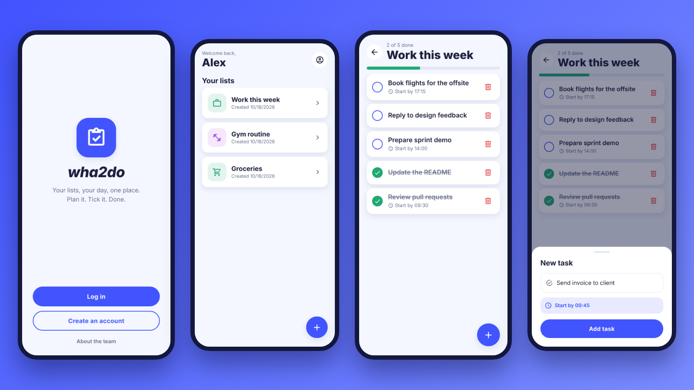
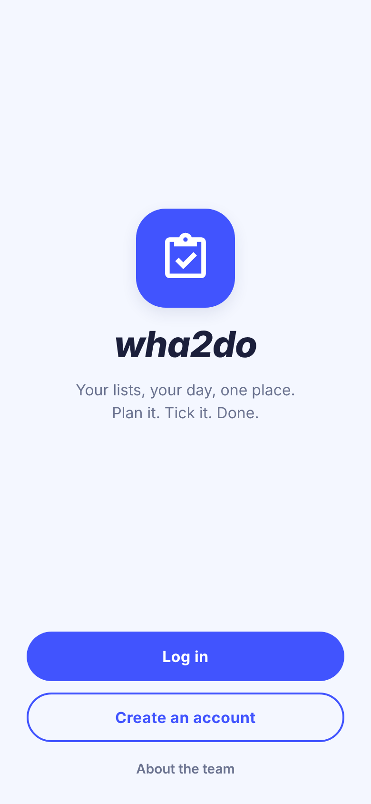
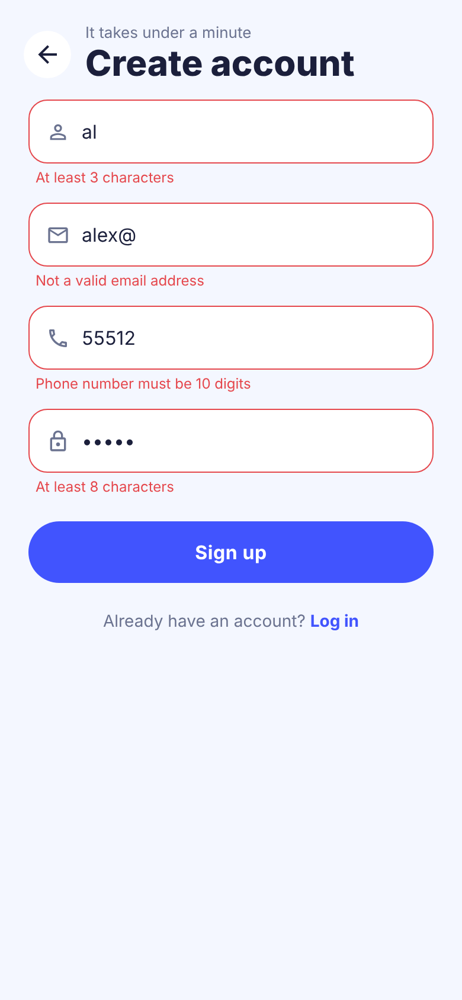
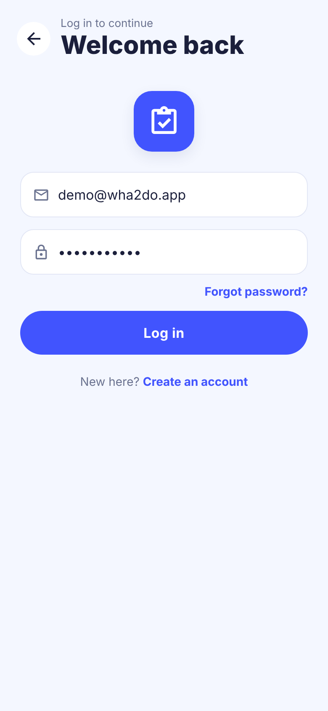
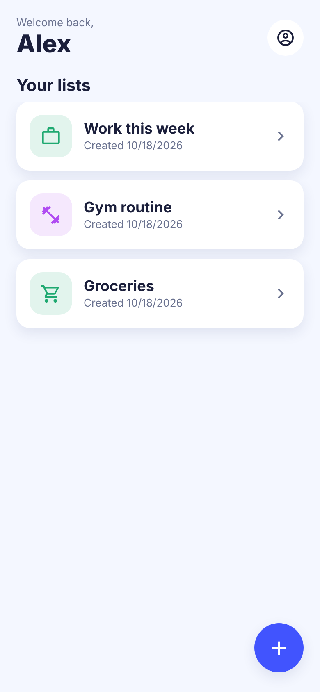
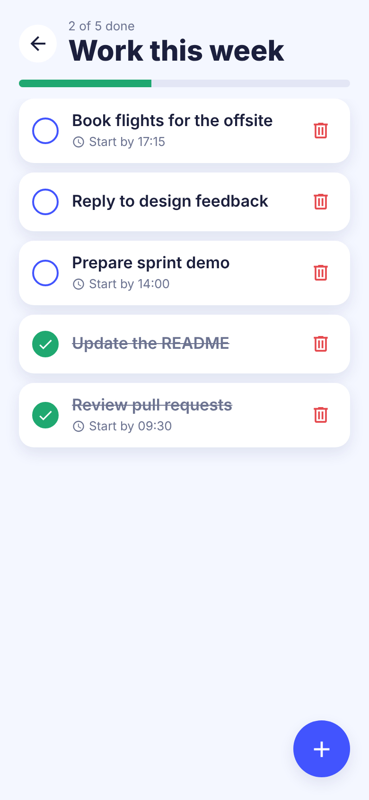
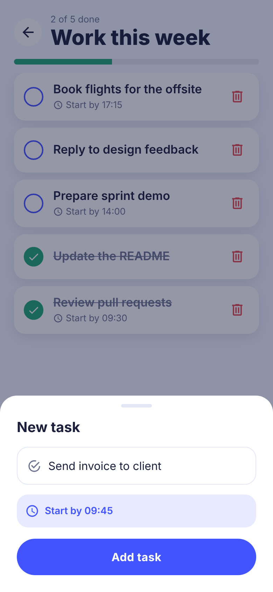
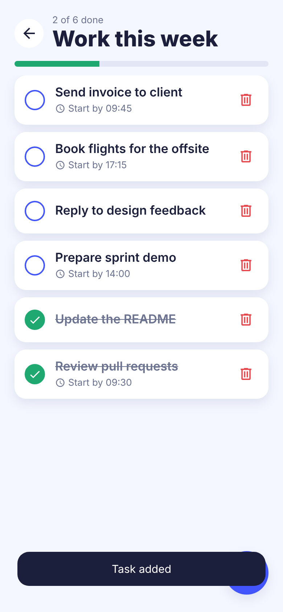
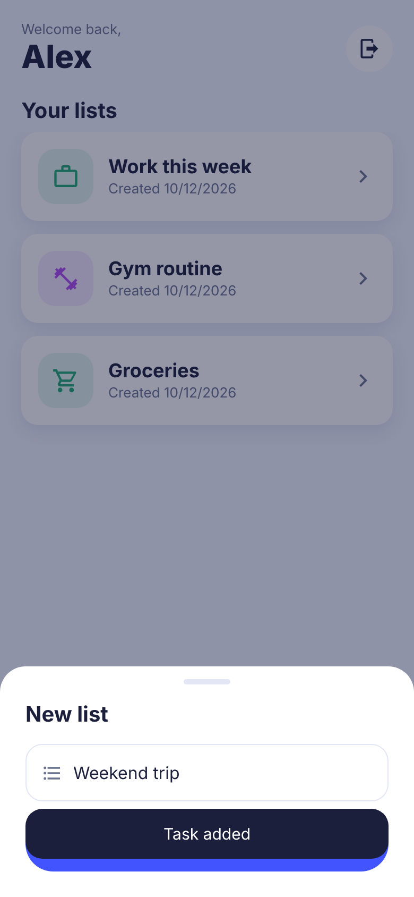

<div align="center">

# wha2do

**A to-do list and day planner for Android, built with React Native and Firebase.**

Create lists, add tasks with a start time, tick them off, and watch your progress bar fill up.



</div>

## Demo

[](docs/demo/wha2do-demo.mp4)

A one-minute walkthrough with a moving camera (3D tilt, zooms and pans): sign up, create a list, add tasks, tick them off. Click it for the full 1080p video **with sound**
([`docs/demo/wha2do-demo.mp4`](docs/demo/wha2do-demo.mp4)); the GIF is silent. The soundtrack is an original jingle and sound effects synthesised in code
([`preview/make-audio.py`](preview/make-audio.py)), so there is nothing to license. It is rendered from the browser preview, see below.

## Features

- **Accounts** with email and password (Firebase Auth): sign up with validation, log in, stay signed in, reset a forgotten password by email.
- **Lists** for anything you want to organise, such as Groceries, Gym or Work. Each list gets a matching icon and colour automatically.
- **Tasks** with an optional start time. Tap the circle to complete a task (finished tasks sink to the bottom), tap the bin to delete it.
- **Progress** at a glance: "2 of 5 done" with a progress bar on every list.
- **Live sync**: lists and tasks are stored per user in the Firebase Realtime Database and update instantly.
- Friendly empty states, in-app toasts and clear error messages.

## Screenshots

<table>
  <tr>
    <td align="center"><br><sub>Welcome</sub></td>
    <td align="center"><br><sub>Sign up, with validation</sub></td>
    <td align="center"><br><sub>Log in</sub></td>
    <td align="center"><br><sub>Your lists</sub></td>
  </tr>
  <tr>
    <td align="center"><br><sub>Tasks and progress</sub></td>
    <td align="center"><br><sub>Add a task</sub></td>
    <td align="center"><br><sub>Task added</sub></td>
    <td align="center"><br><sub>New list</sub></td>
  </tr>
</table>

> These screenshots are the real app screens rendered in a browser with
> [react-native-web](https://github.com/necolas/react-native-web) and an in-memory Firebase
> stand-in, using made-up demo data. They were not captured from an Android device or emulator,
> so native details such as fonts, shadows and the system time picker will differ slightly.
> See [Browser preview](#browser-preview) to reproduce them.

## Tech stack

| Area | Choice |
| --- | --- |
| App | React Native 0.62 (Android), React 16.9 |
| Navigation | React Navigation 5 (stack), switched by auth state |
| Backend | Firebase Auth + Realtime Database (`firebase` JS SDK 7) |
| Forms | Formik + Yup |
| Icons | react-native-vector-icons (Material Community) |
| Tests | Jest + react-test-renderer |

## Getting started (Android)

You need Node, a JDK and the Android SDK, as described in the
[React Native environment setup](https://reactnative.dev/docs/0.62/environment-setup).

```bash
npm install --legacy-peer-deps
npm run android      # with an emulator running or a device attached
npm start            # Metro bundler, if it is not already running
```

### On a Mac

- **Quickest:** use the [browser preview](#browser-preview). It needs only Node and a browser, no Android tooling.
- **Android emulator:**
  1. Install [Android Studio](https://developer.android.com/studio), then in the SDK Manager add an Android SDK platform and an emulator image. On Apple Silicon choose an **ARM64** image.
  2. Install JDK 11 (for example `brew install --cask zulu@11`). The Gradle wrapper (5.5) in this project does not run on newer JDKs.
  3. Add the SDK to your shell profile: `export ANDROID_HOME=$HOME/Library/Android/sdk` and add `$ANDROID_HOME/platform-tools` to `PATH`.
  4. Create and start a virtual device in Android Studio's Device Manager, then run `npm install --legacy-peer-deps && npm run android`.
- **Real phone:** enable USB debugging, plug it in, check `adb devices` lists it, then `npm run android`.
- **iOS:** the `ios/` folder is the untouched 2020 template and has not been maintained, so expect to fix it before it builds.

Because this is React Native 0.62 with the Android Gradle plugin 3.4, newer Mac setups (Apple Silicon, recent Xcode or JDK) can hit
build errors. If so, upgrading React Native is the real fix, see [next steps](#known-limitations-and-next-steps).

### Firebase

The app talks to the Firebase project configured in [`src/firebase.js`](src/firebase.js). To use your
own project, create one in the [Firebase console](https://console.firebase.google.com/), enable
**Email/Password** sign-in and the **Realtime Database**, replace the config object, and publish the
rules in [`database.rules.json`](database.rules.json). They make each user's data readable and
writable by that user only.

Data layout:

```text
users/{uid}/profile              { username, email, phone }
users/{uid}/lists/{listId}       { name, createdAt }
users/{uid}/tasks/{listId}/{id}  { name, time, done, createdAt }
```

Passwords are handled by Firebase Auth only and are never written to the database.

## Browser preview

The `preview/` folder runs the real screens in a browser against an in-memory Firebase mock. It needs
no Firebase project, emulator or Android SDK, which makes it handy for demos and screenshots.

```bash
npm run preview         # dev server, open the printed URL in a phone-sized window
npm run preview:shots   # regenerates docs/screenshots/*.png with Playwright
npm run preview:video   # re-renders docs/demo/wha2do-demo.mp4 and .gif (needs ffmpeg and python3 with numpy; takes about 7 minutes)
```

Log in with `demo@wha2do.app` / `password123`, or create a new account.

## Tests and linting

```bash
npm test        # Jest: data layer, form validation, helpers and an app smoke test
npm run lint
```

## Project structure

```text
App.js                  app root (navigation + toast host)
src/
  navigation.js         auth-driven stack navigator
  api.js                all Firebase calls (auth, lists, tasks)
  firebase.js           Firebase initialisation
  theme.js              colours, radii, shadows, type
  toast.js              tiny toast event bus
  listStyle.js          picks a list icon and colour from its name
  components/           Button, Input, Sheet, Fab, Header, Logo, ...
  screens/              Welcome, Login, SignUp, Lists, Tasks, About
preview/                browser preview and screenshot tooling
__tests__/              Jest tests
android/  ios/          native projects
```

## What changed in the revival

- **Fixed a startup crash.** `SignUp.js` assigned undeclared globals at module level, which throws in strict mode, and `src/config.js` imported a package that was never installed.
- **Stopped storing passwords.** Sign-up used to save an MD5 hash of the password in the database. Firebase Auth already handles credentials, so the profile now holds only the username, email and phone number.
- **Real persistence.** Lists and tasks were kept in component state with hard-coded samples and then lost. They are now stored per user in Firebase and streamed live.
- **Auth-driven navigation.** The navigator shows the onboarding or app screens based on the sign-in state, instead of calling `navigate()` after every login and logout.
- **New design.** A shared theme and component set replaces the nested-`View` layouts, with tap-to-complete tasks, a progress bar, bottom sheets and empty states.
- **Clean-up.** Removed dead screens and unused packages (`md5`, `react-native-paper`, `react-native-swipeout`, Expo leftovers), duplicated Firebase config, debug logging, and stray root-level images.
- **Tests and lint.** Jest was failing before it ran a single test, and ESLint reported over 2,000 problems. Both are now green.

## Known limitations and next steps

- The native Android build was not run while reviving the project. The JavaScript side is tested, but please run `npm run android` once to confirm your toolchain.
- The stack is from 2020 (React Native 0.62, Gradle plugin 3.4). Upgrading React Native, Firebase v9+ (modular SDK) and React Navigation 6 is the natural next step.
- The Firebase project in `src/firebase.js` may no longer exist or accept requests. Use your own project, and restrict its API key in the Google Cloud console.
- iOS code is still in the repo from the template but has not been maintained.

## Team

Built for GMU SWE 632 by [Haramrit Singh Khurana](https://github.com/haramrit09k) and [Neel Narvankar](https://github.com/neelnarvankar30).
